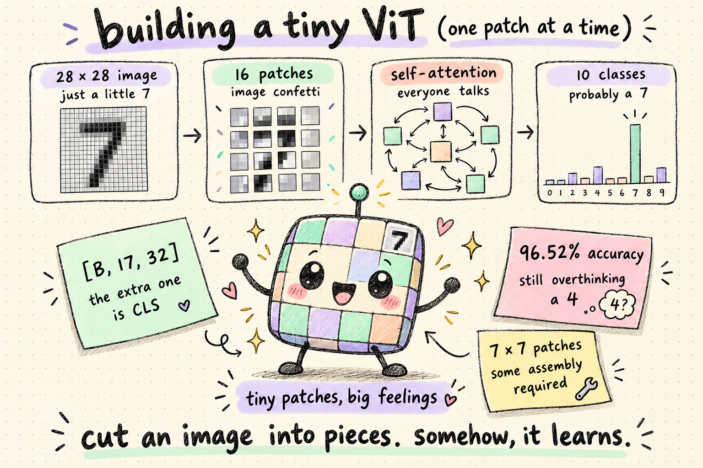

# Vision Transformer in PyTorch



A Vision Transformer implementation for classifying handwritten MNIST digits.

## Model

Each 28 × 28 grayscale image is split into sixteen 7 × 7 patches using a convolution. The patch embeddings are combined with a learned class token and positional embeddings, then passed through four transformer blocks. A linear head uses the class token to predict one of ten digits.

| Setting | Value |
| --- | --- |
| Embedding dimension | 32 |
| Attention heads | 4 |
| Transformer blocks | 4 |
| MLP hidden dimension | 64 |
| Batch size | 64 |
| Optimizer | Adam |
| Learning rate | 0.0003 |
| Loss | Cross-entropy |
| Epochs | 5 |

## Run

Install the dependencies, then start training from the repository root:

```bash
python3 -m pip install torch torchvision
python3 main.py
```

MNIST downloads to `./data` on the first run. The script selects CUDA, Apple MPS, or CPU and prints loss and accuracy after each epoch. It does not save model checkpoints.

## Results

Results from a five-epoch run on Apple MPS:

| Epoch | Train loss | Train accuracy | Test loss | Test accuracy |
| --- | --- | --- | --- | --- |
| 1 | 0.7755 | 76.33% | 0.2785 | 92.15% |
| 2 | 0.2374 | 93.14% | 0.1932 | 94.49% |
| 3 | 0.1715 | 94.89% | 0.1468 | 95.52% |
| 4 | 0.1391 | 95.85% | 0.1451 | 95.57% |
| 5 | 0.1151 | 96.60% | 0.1116 | 96.52% |

The code labels evaluation metrics as validation, but uses the official MNIST test set. There is no separate validation split. Results may vary between runs.

## Files

- `src/model.py` — patch embedding, transformer blocks, classification head, and model settings.
- `src/data.py` — MNIST datasets, tensor transform, and data loaders. The loader batch size is set here.
- `main.py` — device selection, training, and evaluation.
